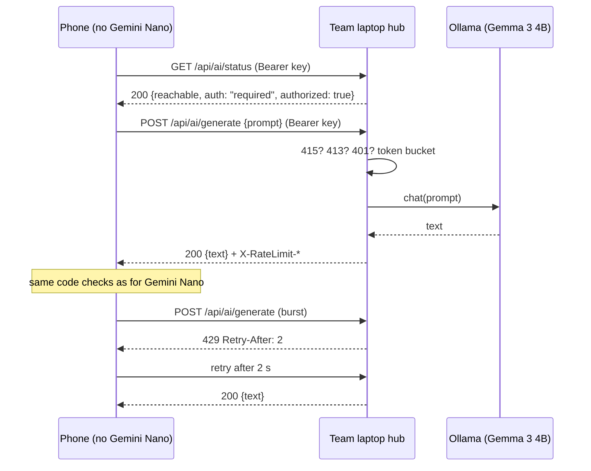

# LakbayMate APIs

LakbayMate's AI runs on the phone. Two optional REST APIs sit beside it:

- **LakbayMate Hub** (the team laptop, Next.js + Ollama): lends the laptop's model to phones without Gemini Nano, over the laptop's hotspot or the same Wi-Fi. No internet.
- **LakbayMate Cloud** (FastAPI on Render + Supabase): encrypted backup and reference data, over HTTPS. Never used for AI.

Both use JSON over HTTP, standard methods, and standard status codes.

## Hub: base URL, authentication, rate limits

- **Base URL:** `http://<laptop address>:3000`, for example `http://192.168.137.1:3000` on a Windows hotspot. It is plain HTTP inside the team's own hotspot; to expose it beyond that, put it behind an HTTPS reverse proxy.
- **Authentication (Bearer):** set `LAKBAYMATE_HUB_KEY=<team key>` in `.env.local` on the laptop. Every AI request must then send `Authorization: Bearer <team key>`; otherwise the hub answers `401` with `WWW-Authenticate: Bearer realm="LakbayMate Hub"`. The phone stores the key in **AI Lab → Team laptop AI**. Without the variable the hub is open, for use on a private network. `GET /api/ai/status` is public and read-only.
- **Rate limit (token bucket):** one laptop GPU serves the whole team, so each client gets bursts of 20 requests and then 30 a minute (one token every 2 s). Every guarded answer carries:

| Header | Meaning |
|---|---|
| `X-RateLimit-Limit` | Bucket size (20) |
| `X-RateLimit-Remaining` | Requests left right now |
| `X-RateLimit-Reset` | Unix time (seconds) when the bucket is full again |
| `Retry-After` | On `429` only: seconds to wait |

  The phone honours `Retry-After` (waits up to 10 s, then retries once) before falling back to its offline path.
- **Format:** `POST` bodies must be JSON (`Content-Type: application/json`), or the hub answers `415`. Oversized bodies get `413`.

Implementation: `src/lib/server/guard.ts` (wraps every AI route), `src/lib/server/limits.ts` (token bucket and key check, unit-tested), `src/lib/apiErrors.ts` (what the phone shows for each status).

## Hub endpoints

| Method | Path | Key | Body | Answer |
|---|---|---|---|---|
| GET | `/api/ai/status` | no | — | `200` models, GPU/CPU, `auth: "open" \| "required"`, `authorized` |
| POST | `/api/ai/generate` | yes | `{ prompt, temperature?, maxTokens? }` | `200 { text, meta }`: runs one of the phone's own prompts; the phone checks the answer exactly as it checks Gemini Nano's |
| POST | `/api/ai/quicklog` | yes | `{ text, today? }` | `200 { records, meta }`: Taglish spending → records |
| POST | `/api/ai/receipt` | yes | `{ image: base64, today? }` | `200 { receipt, meta }`: receipt photo → items (vision model) |
| POST | `/api/ai/advise` | yes | `{ question, context, history? }` | `200` streamed plain text (chunked) |
| POST | `/api/ai/warmup` | no | — | `200` status after loading the models (rate limited) |

**Synchronous and streaming.** `generate`, `quicklog` and `receipt` are synchronous: the answer is in the response. `advise` streams text as the model writes it, so the phone can show it word by word. On the phone every call is asynchronous, so the screen never freezes, and Gemini Nano calls time out after 30 s.

## Examples

```bash
curl -s http://192.168.137.1:3000/api/ai/status

curl -i -X POST http://192.168.137.1:3000/api/ai/generate \
  -H "Content-Type: application/json" \
  -H "Authorization: Bearer barkada" \
  -d '{"prompt":"Say in natural Japanese: Can I pay by card?","maxTokens":60}'
```

```python
import requests, time

HUB = "http://192.168.137.1:3000"
HEADERS = {"Authorization": "Bearer barkada"}

def generate(prompt):
    for _ in range(2):
        r = requests.post(f"{HUB}/api/ai/generate", json={"prompt": prompt}, headers=HEADERS, timeout=90)
        if r.status_code == 429:                      # shared GPU: wait as asked, retry once
            time.sleep(int(r.headers.get("Retry-After", "2")))
            continue
        r.raise_for_status()                          # 401 wrong key, 415 not JSON, 503 Ollama down...
        print("left this minute:", r.headers["X-RateLimit-Remaining"])
        return r.json()["text"]
```

## Status codes and what the phone tells the user

| Code | Meaning here | Phone shows / does |
|---|---|---|
| 200 | Answered | Uses it after its code checks |
| 400 | Bad request (empty prompt, missing field) | The hub's message |
| 401 | Missing or wrong team key | "The laptop hub needs the team access key" |
| 413 | Body too large | "Too big to send; try a smaller photo" |
| 415 | Not JSON | "The app sent the wrong format" |
| 429 | Over the rate limit | Waits `Retry-After` (≤ 10 s), retries once, else "The laptop is busy" |
| 500 | Hub error | "The laptop hub had a problem" |
| 502 / 503 | Ollama gave a bad answer / isn't running | "Start Ollama on the laptop" |
| 504 | Model too slow | "The laptop's AI took too long" |

**Troubleshooting a connection:** AI Lab → Team laptop AI shows *Connected · model*, *needs the access key*, or *can't reach*. Can't reach means the phone isn't on the laptop's hotspot or Wi-Fi, the hub isn't running (`npx next start -H 0.0.0.0 -p 3000`), or the firewall blocks Node.js. `curl <hub>/api/ai/status` from the laptop separates a hub problem from a network one.

## Sequence



## Cloud (optional, HTTPS)

| Method | Path | Auth | Purpose |
|---|---|---|---|
| GET | `/health` | none | Liveness |
| GET | `/v1/reference` | none | Exchange rates and economic figures (read-only) |
| PUT | `/v1/backup` | Bearer (Supabase session) | Save an end-to-end encrypted backup; the server stores ciphertext only |
| GET | `/v1/backup` | Bearer | Fetch it (`404` if none) |
| DELETE | `/v1/backup` | Bearer | Delete it |

Errors: `401` sign in or expired session, `404` no backup, `502` storage failed, `503` backup not configured.

## Not used, on purpose

**Webhooks** need a public URL that is always reachable; LakbayMate is built to work with no internet, so nothing calls back into it. The closest things are on the phone: Android's share sheet pushes a host's message into Usap, and the app's stores notify screens of changes (observer pattern) instead of polling.
